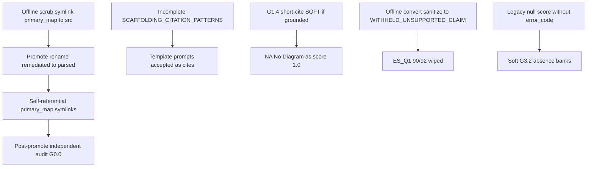

# Post-Promote Citation/Rationale Remediation Roadmap

**Date:** 2026-10-03  
**Trigger:** Independent Antigravity review (YELLOW) of promoted `ai_cache_v5_parsed`  
**Verified on Spark:** circular `*.primary_map.json` symlinks (`OSError: Errno 40`); `null_null` withholds = 1,330; `ES_Q1` withheld = 90/92 (87× `WITHHELD_UNSUPPORTED_CLAIM`)

---

## Critique disposition (accept / reject / narrow)

| Critique | Verdict | Why |
|---|---|---|
| Circular primary_map symlinks break promoted cache | **Accept P0** `[Certain]` | Confirmed: each map points at itself under `ai_cache_v5_parsed/`. Caused by scrub `symlink_to(src)` then promote rename of remediated→parsed. Backup maps are real files. |
| Pre-promote audit missed symlink break | **Accept** `[Certain]` | Audit ran against remediated before rename; no post-promote integrity check. |
| `Vaanelai` `IS_Q21` score 1.0 on template “Markets: Describe…” | **Accept** `[Likely]` | Template prompt is not founder evidence; scaffolding regex incomplete. |
| `PMF_Q5` worksheet cite on score 0.0 × many cos | **Accept as G1.2 bug; narrow G3.1 ask** | Zero-score uniqueness exemption was intentional. Real gap is **scaffolding not detected** (G1.2), not “make all zero-score cite clones HARD.” |
| Soft G3.2 absence clusters (PMF_Q27×60 etc.) prove uniqueness still broken | **Reject as HARD reopen** | Soft true-negative similarity was an explicit remediation policy to avoid hallucinated uniqueness. Treat as signal, not RED. |
| 1,330 `predicted_val=null` + `error_code=null` are “shadow withholds” | **Accept** `[Certain]` | Confirmed count. They look like answers (absence prose) and inflate soft clone counts. |
| G1.4 proper-name loophole (`NA`, `No`, `## Diagram`) | **Accept** `[Certain]` | Length exemption without entity/denylist is wrong for diligence usability. |
| Telegraphic G2.1 (5,868 soft) needs full rewrite | **Narrow** | Soft by design; do not full-rescore 26% of cohort. Fix via prompt + selective regen of worst non-zero short rationales later. |
| Expand scaffolding regexes (sampling / markets / use of funds) | **Accept** | Matches remaining template leaks. Pair with corpus re-clean for affected files. |
| Stamp all null/null with `NO_EVIDENCE_FOUND` + null rationale | **Accept with code name** | Use `NO_EVIDENCE` (or reuse `WITHHELD_UNGROUNDED` only if truly ungrounded). Prefer new code for clarity. |
| Regen all `ES_Q1` without requiring literal “SDG” | **Partial — redesign, don’t loosen blindly** | Wipe is real (87 unsupported-claim withholds). Blind “no SDG required” will reintroduce invented SDG numbers. Need accept-rule + prompt redesign that allows narrative impact cites without `$/%/SDG N` invention. |
| Patch G3.1 to clone-detect across all scores | **Narrow** | Flag identical cites across ≥2 cos when **scaffolding** or **any non-zero** member exists. Do not HARD-flag shared zero-score founder phrases. |

---

## Root-cause map

---

## Roadmap waves

### Wave 0 — Restore operability (same day, no LLM) — DONE 2026-10-03
**Goal:** Promoted cache readable; independent audit runnable.

1. Replace every `ai_cache_v5_parsed/*.primary_map.json` circular symlink with a **real file copy** from `ai_cache_v5_parsed_pre_remediation_20261003T214821Z/`.
2. For companies whose primary maps were refreshed during regen (sample/follow-up), prefer the newest good map if present under backup of remediated workdirs; else backup is fine, then rebuild maps for companies that were corpus-recleaned.
3. Add `scripts/check_cache_integrity.py`: fail if any `*.primary_map.json` is a symlink loop / unreadable / empty; fail if company json count ≠ map count.
4. Re-run independent auditor on promoted path; expect no G0.0. Document baseline HARD/SOFT after restore (may still be YELLOW on G1.2 once maps work).

**Exit:** Maps readable; integrity check GREEN; independent audit exits without symlink errors.

**Wave 0 result:** Restored **92/92** real maps from backup; integrity GREEN; independent audit GREEN HARD=0 / SOFT=12,390 (no G0.0). Closeout: `citation_wave0_closeout.json`. Also fixed `remediate_v5_cache_offline.py` to **copy** maps (never symlink) so promote cannot recreate loops.

### Wave 1 — Offline hygiene (no LLM) — DONE 2026-10-04
**Goal:** Remove fake-answer shadows and junk short cites from ops SoR.

1. Offline pass on promoted cache:
   - If `predicted_val is None` and `error_code is None` → set `error_code=NO_EVIDENCE`, `rationale=null`, `citation=null`.
   - If non-zero score and citation ∈ denylist / non-entity micro-stub (`na`, `n/a`, `no`, `none`, `yes`, markdown-only tokens) → convert to withhold `WITHHELD_UNGROUNDED` (or keep score 0.0 + null cite only when rubric is explicitly binary-negative — default: withhold).
2. Expand `SCAFFOLDING_CITATION_PATTERNS` (+ catalog UNIVERSAL items) for:
   - customer-interview sampling worksheet lines
   - “Markets: Describe the size and growth rate…”
   - “size the second and third markets…”
   - “use of funds: specific product, market…”
3. Offline: any citation matching scaffolding → null cite; if score > 0 → withhold `WITHHELD_UNGROUNDED`; if score == 0 → keep 0.0 with null cite + short company-specific absence rationale **or** `NO_EVIDENCE` if no usable rationale.
4. Tighten auditor G1.4: SOFT proper-name exemption only when cite matches entity heuristic (capitalized multi-char token / known org pattern) **and** not in denylist.
5. Narrow G3.1: index cites for clustering if `is_scaffolding_citation` **or** score non-zero (not “all zeros forever”).

**Exit:** Engineered/shadow nulls stamped; known template cites stripped; auditor policy updated; integrity check still GREEN.

**Wave 1 result:** Shadow→`NO_EVIDENCE` **1,330**; scaffolding stripped **27** (2 non-zero withheld); junk/non-entity micro withholds **132**; scaffolding/junk left **0**; integrity GREEN; independent **HARD=0** / SOFT=11,013. Closeout: `citation_wave1_closeout.json`.

### Wave 2 — Targeted LLM regen (small) — DONE 2026-10-04
**Goal:** Repair high-value wipeouts and residual template/non-zero failures without full 92×282.

1. Manifest from Wave 1 flags + known failures:
   - All `ES_Q1` rows with `WITHHELD_UNSUPPORTED_CLAIM` / null (≤90)
   - Non-zero rows that lost cites to new scaffolding patterns (e.g. `Vaanelai` `IS_Q21`)
   - Optional: top N short non-zero rationales (G2.1) if capacity remains — **cap** (e.g. 200), not 5,868
2. `ES_Q1` accept/prompt redesign (do this *before* regen):
   - Allow narrative impact evidence without requiring literal `SDG N` in primary.
   - Still HARD-block invented `SDG N` / `$` / `%` not in citation span.
   - Prefer score options tied to evidence strength; withhold only when no grounded impact narrative exists.
3. Sample gate: 5 companies including `Vaanelai` + 2 high-`ES_Q1`-withhold cos → independent HARD=0 under updated gates.
4. Full manifest regen for Wave 2 rows only; peer clone check on cite+rationale for non-zero.

**Exit:** `ES_Q1` scored coverage recovers materially (target: withheld ≤ 20% unless truly no impact text); `IS_Q21`-class template non-zero cites gone; independent HARD=0.

**Wave 2 result:** Accept-path allows grounded impact narrative without literal SDG label; invented `SDG N` still withheld. Manifest 92 rows; sample 5 GREEN HARD=0; full regen 86/86. `ES_Q1` scored **78/92** (77×1.0, 1×0.0), withheld **14/92 (15.2%)**. Scaffolding nonzero left **0**. Integrity GREEN; independent **HARD=0** / SOFT=11,055. Closeout: `citation_wave2_closeout.json`. No Supabase push.

### Wave 3 — Process / promote hardening (prevent recurrence) — DONE 2026-10-04
1. Offline scrub: **copy** primary maps, never symlink into a directory that may be renamed over the source.
2. Promote checklist script: integrity → independent audit → v5 grounding → only then atomic promote; refuse promote if maps are symlinks.
3. Update `docs/KNOWLEDGE_BASE.md` + closeout with Wave 0–2 before/after.
4. Still **no Supabase push** — interface remains human-only; gate refuses `--allow-supabase`.

**Exit:** Written promote gate; KB updated.

**Wave 3 result:** `scripts/promote_cache_gate.py` enforces integrity → independent HARD=0 → v5 grounding PASS → optional atomic `--apply`; refuses symlink maps and any Supabase push. Scrub post-copy assert refuses leaving symlink maps. Check-only on live `ai_cache_v5_parsed`: **GREEN**. Closeout: `citation_wave3_closeout.json`. **No Supabase push.**

### Explicit non-goals (this roadmap)
- Reopening HARD uniqueness on all true-negative absence clones
- Full cohort rescore for short G2.1 rationales
- Re-enabling AI citations in judge UI
- Blind “drop SDG grounding entirely” for all ES questions

---

## Priority order (execution)

| Order | Item | Effort | Risk if skipped |
|---|---|---|---|
| 1 | Wave 0 restore primary maps + integrity check | Minutes | Cache unusable; any audit/tooling lies |
| 2 | Wave 1 stamp `NO_EVIDENCE` + scaffolding expand + G1.4 denylist | Hours | Template/junk cites remain; soft clone noise |
| 3 | Wave 2 `ES_Q1` accept redesign + selective regen | Hours–½ day GPU | Category effectively empty for ops QA |
| 4 | Wave 2 residual template non-zero regen | Small | Known false 1.0s remain |
| 5 | Wave 3 promote hardening | Hours | Same symlink bug on next promote |

---

## Success metrics

| Metric | Current (post-critique) | Target after Waves 0–2 |
|---|---|---|
| Primary maps readable | 0/92 | **92/92** |
| Independent audit runnable on promoted path | Broken G0.0 | Runs cleanly |
| Independent HARD | Unknown post-fix / was 0 pre-break | **0** under updated gates |
| Engineered rationale strings | 0 | **0** |
| Shadow withholds (`null`/`null`) | 1,330 | **0** |
| `ES_Q1` withheld | 90/92 (97.8%) | **≤ ~18/92 (20%)** unless true no-evidence |
| Known template non-zero cites (`IS_Q21`-class) | ≥1 | **0** |
| Soft absence clones | Allowed | Allowed (reported only) |

---

## Confidence

- Symlink / shadow-withhold / `ES_Q1` wipe: **Certain** (re-verified on Spark).
- Template scaffolding gaps and G1.4 loophole: **Certain** as mechanisms; per-row counts from critique treated as **Likely** pending Wave 0 re-audit with fixed maps.
- Soft G3.2 “must become HARD”: **Rejected** as policy regression.
